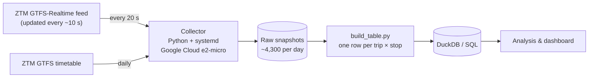

# How reliable is Poznań's public transport timetable?

An end-to-end data project: I collect the live position and delay of every tram and bus in Poznań every 20 seconds, compare it with the published timetable, and look for lines, stops and hours where the schedule cannot be trusted.

> **Status:** 🟢 data collection running since 4 Oct 2026 · 🟡 building the trip × stop table · ⚪ analysis and dashboard next

## Questions

- Which lines and stops are systematically late (or early)?
- At what times of day and on which days does punctuality break down?
- How do weather, weekends and public holidays (1 Nov, 11 Nov) change the picture?
- Do vehicles bunch — two arriving together after a long gap?

## Data

| Source | What it contains | How often I save it |
|---|---|---|
| ZTM Poznań GTFS-Realtime (`feeds.pb`) | position of every vehicle + its current delay | every 20 s (feed refreshes every ~10 s) |
| ZTM Poznań GTFS timetable | planned stop times for every trip | daily (ZTM publishes ~12 versions a month) |
| ZTM vehicle dictionary | tram/bus, low floor, air conditioning… | daily |

**Collected so far (11 Nov 2026):** 38 full days, ~4,300 snapshots per day, ~165,000 snapshots, 6.9 GB of raw data, no missing days.

## Pipeline



- **Collection** runs 24/7 on a free-tier Google Cloud VM as a systemd service: it restarts itself after failures, skips duplicate snapshots, validates every download and stores everything in UTC.
- **Processing** turns ~4,300 snapshots per day into ~245,000 rows: for every trip run and every stop — when the vehicle was there, which delay ZTM reported and where the vehicle was.

## What I have learned about the data so far

Checks on one full weekday (5 Nov 2026, `processing/explore_day.py`):

1. **Realtime trips match the timetable.** 10,545 of 10,569 trip runs (99.8%) have a matching `trip_id` in the GTFS timetable, so planned and actual times can be joined directly.
2. **One delay per vehicle — but it moves along the route.** Each update carries a single stop (`stop_sequence` + delay, no `stop_id`). Followed over time, `stop_sequence` advances: a median of 23 different stops is observed per trip, and for 97% of trips at least 80% of their stops are observed. Per-stop delays can therefore be rebuilt without map-matching GPS points.
3. **The layover trap.** While a vehicle waits at the first stop, its reported delay counts up from a negative value to zero — e.g. line 215 at Luboń/Kręta: −16:07 → 0:00 in 20-second steps. Taken at face value, 24% of raw observations look more than a minute *early* — much of that is vehicles waiting at the terminus, not running early. So the analysis uses the moment a vehicle **leaves** a stop.
4. **Damaged downloads are rare.** 2 of 4,255 snapshots (0.05%) were truncated mid-download; they are skipped.
5. **Time zones matter.** All data is stored in UTC; the collection period spans the switch from summer to winter time on 25 Oct 2026. `vehicle.timestamp` equals the feed time, not the GPS fix time.

## Repository structure

```
collector/
  collector.py      downloads the realtime feed every 20 s, timetable + vehicle dictionary daily
  install.sh        installs the collector as a systemd service
  ztm-status.sh     one-command health check
processing/
  explore_day.py    first look at one day: data quality, matching, delay distribution, one trip step by step
  build_table.py    raw snapshots -> one compressed CSV per day, one row per trip × stop
requirements.txt
```

Raw and processed data are not part of the repository (see *Data source* below).

## Reproduce

```bash
# on a Debian/Ubuntu machine that stays on
git clone https://github.com/<your-username>/ztm-poznan-punctuality.git
cd ztm-poznan-punctuality
bash collector/install.sh          # starts collecting into ~/ztm_data
ztm-status                         # health check

# after a few days
python3 -m venv ~/venv && ~/venv/bin/pip install -r requirements.txt
~/venv/bin/python processing/explore_day.py 2026-11-05
~/venv/bin/python processing/build_table.py
```

## Roadmap

- [x] Validate the feeds (trip matching, meaning of the delay field)
- [x] 24/7 collector on a free-tier cloud VM
- [x] Data-quality check of one full day
- [ ] Trip × stop table for all days
- [ ] Join with the timetable version valid on each day; verify `stop_sequence` semantics with stop coordinates
- [ ] Metrics: on-time share (−1 to +3 min), delay by line / stop / hour / weekday, bunching
- [ ] Weather (Open-Meteo), weekends and public holidays
- [ ] Dashboard and write-up

## Tools

Python (protobuf, csv, gzip), Linux & systemd, Google Cloud Compute Engine; next: SQL in DuckDB, Tableau Public.

## Data source

Data source: **Zarząd Transportu Miejskiego w Poznaniu** ([ztm.poznan.pl](https://www.ztm.poznan.pl/otwarte-dane/dla-deweloperow/)) — GTFS and GTFS-Realtime open data.
Data period: from 4 Oct 2026 (collection ongoing); timetable versions downloaded daily.
The data has been processed by the author (*dane zostały przetworzone przez autora*). Raw data is not redistributed in this repository.
